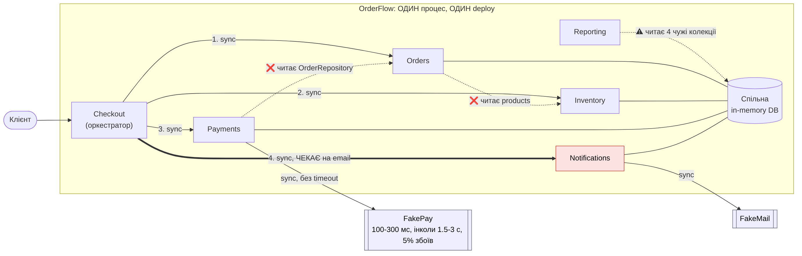
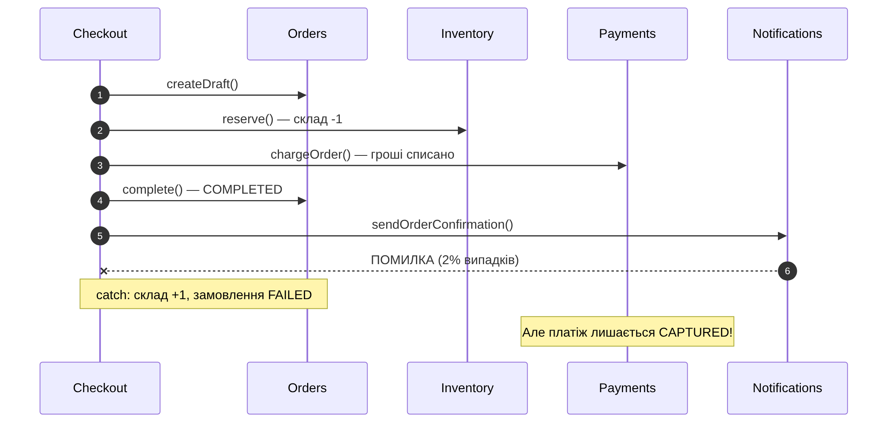
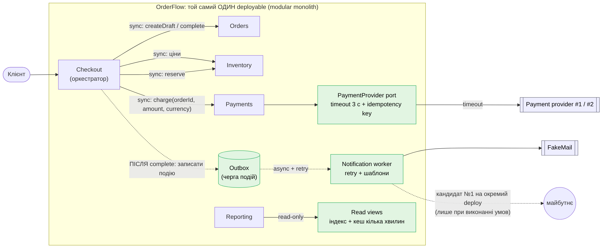
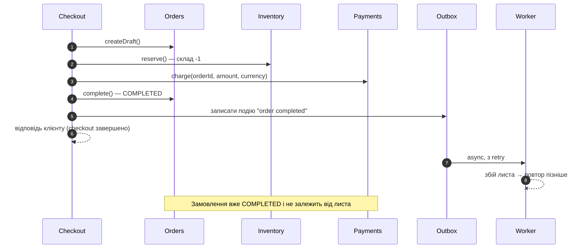
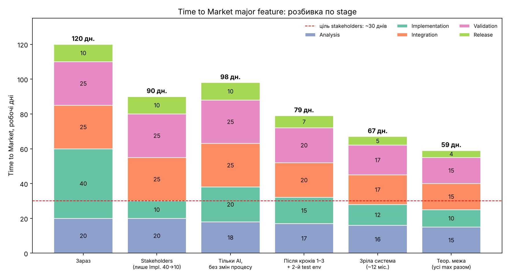

**Архітектурний аналіз і план еволюції**

OrderFlow лишається **modular monolith**. Я не пропоную переходити на мікросервіси, а виправляю три конкретні межі всередині застосунку. Головна проблема, яку я знайшла в коді: збій відправки листа після оплати ламає замовлення (воно стає `FAILED`, хоча гроші вже списані). Тому відправку листа я виношу з критичного шляху checkout. Ціль «1 місяць» для major feature я вважаю нереалістичною: мій прогноз 2,5–3 місяці зараз і ≈2–2,5 на зрілій системі

---
## 1. Поточна архітектура



Увесь застосунок працює в одному процесі з однією in-memory базою й одним deploy. Checkout контролює та він послідовно й синхронно викликає Orders, Inventory, Payments і Notifications. Пунктирні стрілки це залежності від чужих внутрішніх даних, товста стрілка це місце, де Checkout чекає на лист.

| Модуль | Відповідальність | Власні дані |
|---|---|---|
| Checkout | Порядок кроків і реакція на збій | немає |
| Orders | Створення замовлення, його статус | `orders` |
| Inventory | Залишки, резервування, повернення | `products`, `inventoryOperations` |
| Payments | Виклик провайдера оплат, запис платежу | `payments` |
| Notifications | Формування й відправка email | `notifications` |
| Reporting | Звіти | лише читає |

### Прямі звернення до чужих даних

Я перевірила їх двома способами: за `database.` і за викликами чужих репозиторіїв. Другий спосіб був потрібен, бо перший пропускав `PaymentService:12`.

| Де (оригінальний код) | Що читає | Чиє | Вердикт |
|---|---|---|---|
| `PaymentService.js:12` | `OrderRepository.findById` | Orders | Виправляю першим |
| `OrderService.js:16` | `database.products` | Inventory | Виправляю (метод Inventory) |
| `ReportingService.js` | orders, payments, notifications, products | чужі | Залишаю: лише читання |

Жодного **запису** в чужі колекції немає. Це важливо: цілісність даних не під загрозою, тому не кожну залежність я вважаю помилкою.

### Де ламається checkout



Лист надсилається після списання грошей, але всередині того ж try. Якщо лист не надіслався (за конфігом це 2% випадків), catch повертає товар на склад і ставить замовлення в `FAILED`. Платіж лишається `CAPTURED`, а методу refund у коді немає. Підсумок: клієнт заплатив, система вважає замовлення проваленим, а товар знову доступний для продажу

---
## 2. Proposed architecture



Зелені блоки це нові елементи. Deployable залишається одним

| # | Зміна | Навіщо |
|---|---|---|
| 1 | Payments отримує `{orderId, amount, currency}` параметрами від Checkout | Явний контракт; зміна Orders не зачіпає Payments |
| 2 | Провайдер оплат за інтерфейсом (port) із timeout і idempotency key | Повільний провайдер не блокує checkout; легко додати другого (Scenario B) |
| 3 | Лист ставиться в outbox після `complete()`, worker відправляє з повторами (**async**) | Збій листа не чіпає замовлення (Scenario E) |
| 4 | Orders бере ціни через метод Inventory | Чіткий власник даних |
| 5 | Reporting: індекс замість `.find`, кеш на кілька хвилин | Дешево готує до росту трафіку (Scenario C) |



Після `complete()` замовлення вже остаточне, а лист відправляється окремо й з повторами.

---
## 3. Рішення

### 3.1 Проблема
Прості зміни дедалі частіше зачіпають кілька модулів, а збій другорядного кроку (лист) руйнує коректність головного (замовлення з оплатою).

### 3.2 Підтвердження

| Факт | Джерело | Сила |
|---|---|---|
| Збій листа → `FAILED` при `CAPTURED`; тест падає | код, fitness-тест | Сильна |
| 37% змін шаблонів потребують повного regression checkout | `engineering-metrics.md` | Сильна |
| 48% feature PR торкаються Orders і Payments | `engineering-metrics.md` | Середня |
| Modules per Feature 1,7 → 4,3; Rollback 2% → 9%; Lead Time 2 → 6 днів | `engineering-metrics.md` | Узгоджується, не доводить причину |
| Два останні інциденти почалися з latency провайдера; виклик без timeout | метрики, код | Середня (2 з 5 інцидентів) |

Чого я не використовую як доказ. Deployment Duration (8 → 27 хв): частина росту це ручні approval і розширений test suite, тобто процес, а не архітектура. Reporting traffic ×3: ріст є, але шкоди від нього поки немає.

### 3.3 Рішення

Proposal «independently deployable services» я приймаю частково

| Пункт proposal                                    | Рішення                         | Причина                                                                     |
| ------------------------------------------------- | ------------------------------- | --------------------------------------------------------------------------- |
| Contracts між modules; прибрати чужі repositories | Прийнято (Payments, Orders)     | Дешево, зменшує coupling                                                    |
| Async messaging                                   | Змінено: лише для Notifications | Eventual consistency потрібна тільки там, де бізнес її допускає             |
| Усі 5 modules як сервіси                          | Відхилено                       | 8 інженерів, 2 QA, немає platform team; біль у межах, а не в одному процесі |
| Окремий data store для Reporting                  | Відкладено                      | Дані «з точністю до хвилин» прийнятні; є дешевші кроки                      |

Пріоритети характеристик

| # | Характеристика | Чому |
|---|---|---|
| 1 | Availability checkout | Прямо визначає revenue |
| 2 | Коректність грошей і складу | Scenario D: затримка прийнятна, overselling ні |
| 3 | Modifiability | Причина змін, але не ціною перших двох |
| 4 | Performance Reporting | Стане критичним лише при ×8–10 |

Для грошей і складу коректність це жорстке обмеження, а не просто пріоритет: якщо провайдер мовчить після timeout, я не знаю, чи списано гроші. Тому timeout іде разом з idempotency key, а availability я купую там, де можна: лист не блокує checkout

### 3.4 Що свідомо не змінюю і коли переглядатиму

| Не змінюю | Чому |
|---|---|
| Modular monolith | Команда мала, немає platform team |
| Idempotency в Inventory (`reserve:${order.id}`) і Payments (платіж `CAPTURED` не списується вдруге) | Покриває Scenario D; майбутні повтори після timeout на неї спираються |
| State machine замовлення (`complete()` вимагає `PAID` і `RESERVED`) | Правило цілісності, воно правильне |
| Копії даних із репозиторію (`structuredClone`) | Через це всі порушення меж це лише читання |
| Reporting як читач чужих даних | Лише читання; окремий store поки дорогий |
| Refund | Ризикований зовнішній крок стоїть останнім перед фіксацією; знадобиться з async-провайдером (Scenario B) |

| Умова | Дія |
|---|---|
| Worker або шаблони листів потребують частіших релізів, ніж 2 deploy/тиждень | Виділити Notifications |
| Звіти збільшують p95 checkout або трафік Reporting ×5 | Виділити Reporting на копію даних |
| Окрема команда на Payments або provider з async-підтвердженням | Рознести Payments, додати refund |
| З'явилась platform-функція (CI/CD і моніторинг на сервіс) | Можна брати нові сервіси |

### 3.5 Компроміси

| Отримую | Плачу |
|---|---|
| Checkout не залежить від листа | Лист може прийти із затримкою |
| Менше модулів на зміну | Новий механізм (outbox, worker), який треба підтримувати |
| Простота deploy і гарантії однієї бази | Лишається один deploy і спільне вікно релізу |

Неочевидний компроміс. Inventory.reserve() синхронний, тому в одному процесі Node він атомарний сам по собі. Якби я винесла Inventory в окремий сервіс, ця гарантія зникла б, а Scenario D вимагає саме її. Складніша архітектура тут означала б ризикованішу

Чому складніша архітектура ще не виправдана. Сервіси додають окремий deploy, моніторинг, синхронізацію даних і нові види збоїв. Усе це лягає на тих самих людей, які вже мають 5 інцидентів на місяць. Потрібний виграш (менше модулів на зміну, лист не блокує checkout) досягається дешевше всередині monolith


---

## 4. Принципи

| Принцип                  | Де порушено зараз                                     | Як змінює рішення                                              |
| ------------------------ | ----------------------------------------------------- | -------------------------------------------------------------- |
| **Explicit Contracts**   | Payments сам дістає суму з Orders                     | `charge({orderId, amountCents, currency})`: видно, що потрібно |
| **Dependency Direction** | Результат замовлення залежить від допоміжного листа   | Лист реагує на завершене замовлення, а не навпаки              |
| **Ownership**            | Ціни й склад в одній структурі, її читає чужий модуль | Дані Inventory доступні через його метод                       |
| **Fitness Functions**    | Тестів на межі немає                                  | Автоматичні перевірки (розділ 6)                               |


---

## 5. Аналіз ризків

Формула з analysis-tools.md : Expected Risk Cost = Probability × Business Impact

| #   | Risk                                                   | Probability           | Impact                          | Expected Risk Cost  | Mitigation                                       |
| --- | ------------------------------------------------------ | --------------------- | ------------------------------- | ------------------- | ------------------------------------------------ |
| 1   | Лист падає після оплати → `FAILED` при списаних грошах | 2% × 30 000 = 600/міс | $15 на випадок                  | **$9 000/міс**      | Outbox + worker; fitness-тест                    |
| 2   | Провайдер без timeout блокує checkout                  | 30%/міс               | ≈ $12 500 (2 год × ≈$6 250/год) | **$3 750/міс**      | Timeout 3 с, idempotency key                     |
| 3   | Reporting блокує процес при ×8–10                      | 40% за 12 міс         | ≈ $9 500                        | **≈ $3 800/12 міс** | Індекс, кеш; умова перегляду                     |
| 4   | **Створює рішення:** outbox дублює або губить листи    | 5%/квартал            | $2 000                          | **≈ $100/квартал**  | Ідемпотентність; durable сховище; алерт на чергу |
| 5   | **Створює рішення:** міграція меж ламає checkout       | 10% на реліз          | $5 000                          | **$500**            | Малі кроки, contract tests, feature flag         |

Ризик 1 виглядає великим, бо базується на 2% збоїв з навчальної конфігурації; у реальній системі треба брати фактичний показник. Ризики 4 і 5 створює саме моє рішення, і я показую їх чесно

---

## 6. Change cost, Metrics і Fitness Functions

### Change cost: Scenario F (нове discount rule, $50/год)

| Параметр | Зараз | Запропоновано |
|---|---|---|
| Modules touched | Orders, Payments, Checkout, Reporting (4) | Orders, Reporting (2) |
| Implementation | 24 год | 16 год |
| Coordination | 8 год | 3 год |
| Testing | 12 год, повний regression | 6 год, contract test |
| Deployment | 4 год | 2 год |
| **Разом** | **48 год = $2 400** | **27 год = $1 350** |

Architecture Tax = $2 400 − $1 350 = **$1 050** на одну зміну. Різниця виникає тому, що Payments більше не змінюється разом з Orders, а сума знижки рахується в одному місці й передається далі.

### Metrics

| Metric | Зараз | Ціль | Чому важлива | Напрям |
|---|---|---|---|---|
| Modules Changed per Feature | 4,3 | < 2,5 | Пряма міра coupling | ↓ |
| Rollback Rate | 9% | < 4% | Якість і розмір змін | ↓ |
| Change Lead Time | 6 днів | ≤ 3 дні | Швидкість реакції на бізнес | ↓ |
| Частка PR на Orders+Payments | 48% | < 20% | Перевіряє причину | ↓ |

### Fitness Functions (`tests/architecture.test.js`)

1. **Збій листа не робить оплачене замовлення `FAILED`.** На оригінальному коді тест падав; після зміни проходить.
2. **Payments не залежить від `OrderRepository` / `database.orders`.** Падає, бо крок 1 ще не зроблений; позначений `todo`, щоб не блокувати `npm test`.

**Що може спростувати мої припущення:** якщо після кроків 1–3 частка PR на Orders+Payments не впаде з 48%, причина не в цій межі, і я відкину гіпотезу.

> **Пояснення.** Fitness function це автоматична перевірка, що архітектура не псується. Тест, який був червоним і став зеленим після виправлення, і є доказом, що проблема була реальною.

---

## 7. AI та Time to Market

**Перевірка припущення stakeholders.** AI прискорює лише Implementation, яка складає 40 з 120 днів (33%).

```text
Зараз:                       20 + 40 + 25 + 25 + 10 = 120 днів
Stakeholders (Impl. → 10):   20 + 10 + 25 + 25 + 10 =  90 днів ≈ 3 місяці
Навіть Impl. = 0:            20 +  0 + 25 + 25 + 10 =  80 днів ≈ 2,7 місяця
```

Місяць неможливий: прискорення однієї частини процесу не може скоротити цілий цикл більше, ніж на її частку (закон Амдала).



| Stage | Зараз | Лише AI | Після змін + 2-й test env | Зріла (~12 міс.) | Припущення |
|---|---:|---:|---:|---:|---|
| Analysis | 20 | 18 | 17 | 16 | AI-research і prototype; залежить від stakeholders |
| Implementation | 40 | 20 | 15 | 12 | AI реально прискорює; finance/security review лишається |
| Integration | 25 | 25 | 20 | 17 | Без контрактів не скорочується; потрібні contract tests |
| Validation | 25 | 25 | 20 | 17 | Один test environment, черга 3–5 днів |
| Release | 10 | 10 | 7 | 5 | Спільне вікно 2 рази на тиждень |
| **TTM** | **120** | **98** | **79** | **67** | |

**Мій target:** ≈ 95–100 днів на найближчу major feature, ≈ 75–85 після кроків 1–3 і другого test environment, ≈ 65–75 на зрілій системі. Теоретична межа з усіх максимальних покращень одразу становить 59 днів, тому й вона не дає місяця. Покращення частково перекриваються, тож їх не можна просто додавати.

**Implementation speed ≠ end-to-end speed.** Швидший код без змін процесу лише подовжує черги перед review, test environment і release.

| Обмеження | Тип | Чому AI не допомагає |
|---|---|---|
| Один test environment (черга 3–5 днів) | Process | Код швидший, черга та сама |
| Release 2 рази на тиждень | Process | Не залежить від коду |
| Review чекає двох senior | Process | Більше PR → довша черга |
| Human review для security/finance | Process | Обов'язкова вимога |
| Зміни зачіпають 4,3 модулі | **Architecture** | Вирішують кроки 1–3 |
| Усі modules в одному release, rollback всього | **Architecture** | Менший deployment scope |

**Що має змінитися для реального місяця:** major feature нарізається на інкременти ≤ 2 modules за feature flags; Analysis іде паралельно з Implementation; Validation автоматизована в CI з окремими environments; release за запитом; більше людей з правом review; менший deployment scope або independent deploy.

**Prerequisites та інвестиції:** кроки 1–3 (≈4–6 людино-тижнів), другий test environment, contract tests, розподіл архітектурних знань.

**Нові ризики від більшого throughput:** черга review (PR вже виріс 180 → 520 LOC); невідомий defect rate AI-коду (немає baseline); більше змін у спільному release → вищий Change Failure Rate; навантаження на test environment.

**Як виміряти вплив AI без LOC:** cycle time по stage, час очікування review, Change Failure Rate, rework за 30 днів, Change Lead Time end-to-end для PR з позначкою AI проти решти.

**Що змусить переглянути прогноз після першої major feature:** Integration + Validation не скоротились хоча б на 5 днів; очікування review > 2 днів; Change Failure Rate AI-PR вищий за решту.

> **Пояснення.** Уявіть конвеєр із п'яти станцій. Stakeholders пропонують прискорити одну в 4 рази й чекають, що весь конвеєр прискориться в 4 рази. Але загальну швидкість задають найповільніші станції, а вони не про написання коду.

---

## 8. Optional implementation: email винесено з checkout

Це реалізація кроку 2 плану

| Файл | Зміна |
|---|---|
| `src/checkout/CheckoutService.js` | Після `complete()` лист лише ставиться в чергу. Виклик стоїть **поза** `try/catch` із відкатом |
| `src/notifications/NotificationService.js` | `enqueueOrderConfirmation` (запис `PENDING`, ідемпотентний) і `dispatchPending` (відправка з повторами, після 5 спроб `FAILED`); `startWorker` для фонової відправки |
| `src/server.js`, `app.js`, `config.js`, `database.js` | Запуск worker, налаштування `NOTIFICATION_MAX_ATTEMPTS`, лічильник id |
| `src/reporting/ReportingService.js` | Лічильники листів `sent / pending / failed` |
| `tests/` | 5 нових тестів на outbox, оновлено 2 існуючі, додано `architecture.test.js` |

| Перевірка                     | До                                       | Після                                                 |
| ----------------------------- | ---------------------------------------- | ----------------------------------------------------- |
| Збій листа після оплати       | `FAILED` при `CAPTURED`, склад повернуто | `COMPLETED`, платіж `CAPTURED`, склад не повертається |
| Fitness function «збій листа» | -                                        | +                                                     |
| `npm test`                    | 5 тестів                                 | 12: `pass 11`, `fail 0`, `todo 1`                     |


**Обмеження реалізації:** черга in-memory і не переживає перезапуск (потрібне durable сховище); між повторами немає затримки; `FAILED` лише видно у звіті, автоматичного алерту немає; поле `notification.status` у відповіді `/checkout` тепер `PENDING`, а не `SENT`, тобто контракт відповіді змінився.

---

## Висновок

Я не пропоную переписувати систему. Спершу лагодимо межі всередині modular monolith: лист виходить із критичного шляху, Payments перестає залежати від внутрішнього класу Orders, провайдер оплат отримує timeout. Сервіси відкладаємо до виконання умов із розділу 3.4. Ціль «1 місяць» нереалістична, бо код це лише третина циклу, а решту обмежують процес і межі між модулями.

## Додаток: припущення

| Припущення | Значення | Джерело |
|---|---|---|
| Checkout на добу | 1 000 (≈30 000/міс) | Моє припущення, у документах немає |
| Середній чек | $150 | Демо-каталог ($29–$279) |
| Ставка інженера | $50/год | `analysis-tools.md` |
| Збої email / повільні виклики / збої платежів | 2% / ~10% / 5% | `src/config.js`, `system-overview.md` |
| Години в change cost, тривалість кроків 1–3 | Експертна оцінка | Перевірити після першої зміни |
